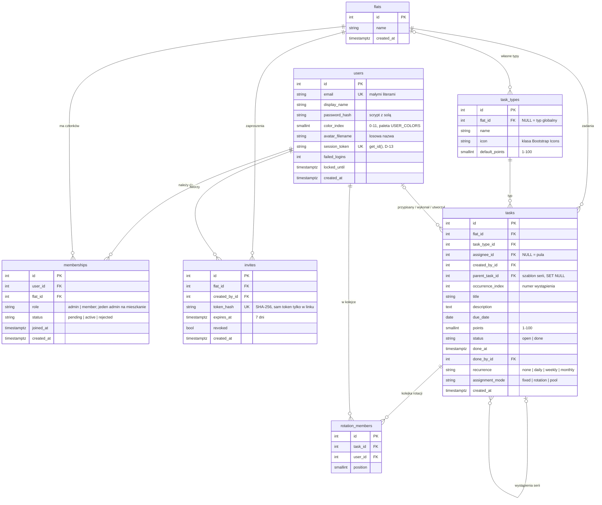

# Diagram bazy danych

Schemat z migracji `backend/migrations/versions/*_schemat_poczatkowy.py`, zgodny z modelami w `backend/models/` (sprawdza to `flask db check` w CI). GitHub rysuje diagram automatycznie. Wcześniejszy `diagram_bazy_danych.png` pokazuje tylko klucze z etapu projektowania.

## Ograniczenia w bazie

| Tabela | Ograniczenie | Po co |
| --- | --- | --- |
| `users` | `email` i `session_token` unikalne; `color_index` 0–11; `failed_logins >= 0` | jedno konto na adres, sesje jednoznaczne |
| `memberships` | unikalna para `(user_id, flat_id)`; indeks częściowy: co najwyżej jeden `admin` w mieszkaniu | brak podwójnych członkostw, niezmiennik roli admina |
| `invites` | `token_hash` unikalny | wyszukiwanie zaproszenia po skrócie tokenu |
| `task_types` | unikalna para `(flat_id, name)`; `icon LIKE 'bi-%'`; punkty 1–100 | ikona trafia do atrybutu `class`, więc tylko klasy Bootstrap Icons |
| `tasks` | unikalna para `(parent_task_id, occurrence_index)`; `status = done` wtedy i tylko wtedy, gdy jest `done_at`; wystąpienie serii nie może się powtarzać; punkty 1–100; opis do 1000 znaków | spójność serii cyklicznych i punktów |
| `rotation_members` | unikalna para `(task_id, user_id)` | osoba raz w kolejce |
| wszystkie | wartości wyliczeniowe jako tekst z `CHECK` (D-22) | nowa wartość to zwykła migracja |

Usunięcie mieszkania kasuje w bazie jego członkostwa, zaproszenia, własne typy i zadania (`ON DELETE CASCADE`). Usunięcie użytkownika zdejmuje go z zadań (`SET NULL`), a usunięcie szablonu serii zostawia wykonane wystąpienia jako historię punktów.
